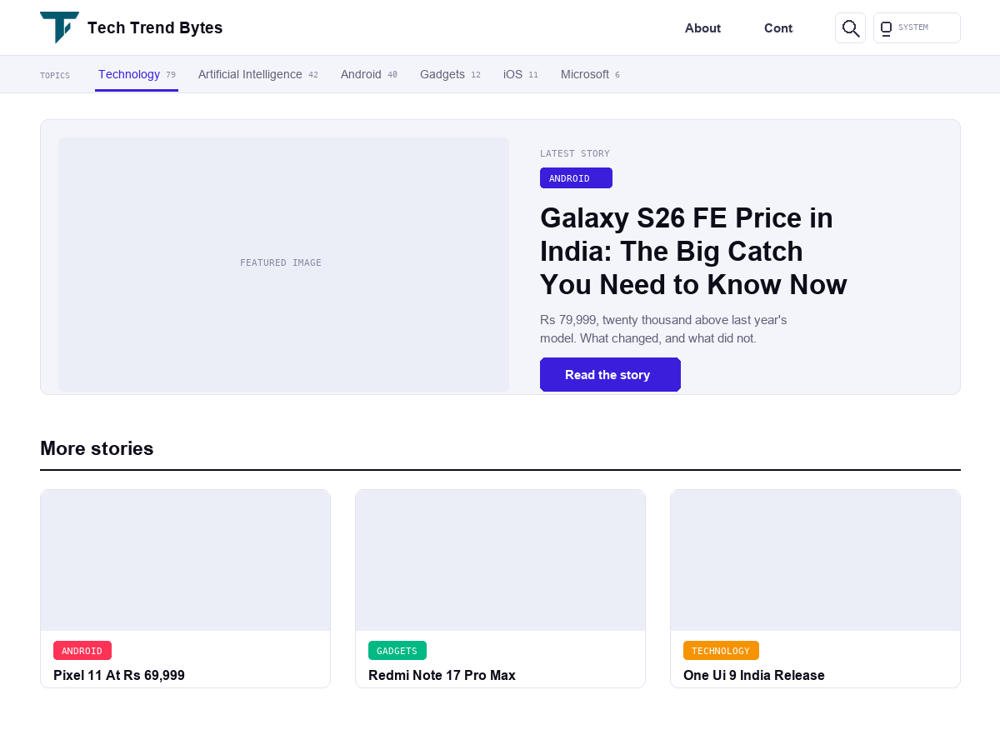

# Tech Trend Bytes

A standalone WordPress theme built from scratch for
[techtrendbytes.com](https://techtrendbytes.com), a tech blog written for readers in India.

No parent theme and no page builder. Every template, style and script belongs to this theme.

## What it does

- **Three appearance modes** — light, dark, and follow-the-system. The choice is remembered in
  `localStorage` and applied before first paint, so there is no flash of the wrong theme.
- **One colour system.** Every colour is a CSS custom property on `:root`, redefined once for
  dark mode. No rule below the token block hard-codes a colour.
- **A full-width story grid** on the homepage and archives, with a lead card for the newest post.
- **Automatic contents list** on long articles, built from the headings at render time.
- **Reading progress bar and reading time**, both calculated without a plugin.
- **LCP image preloading** — the lead image is found server-side and preloaded with
  `fetchpriority="high"`.

## Requirements

- WordPress 6.0 or newer
- PHP 7.4 or newer

## Installing

Download this repository as a ZIP, then in WordPress go to
**Appearance → Themes → Add New → Upload Theme** and select it.

## Structure

| File | What lives there |
|---|---|
| `style.css` | The entire design: tokens, header, grid, article, footer, dark mode, print |
| `functions.php` | Setup, enqueues, image sizes, the LCP preload |
| `inc/template-tags.php` | Output helpers — pagination, meta, contents list |
| `inc/customizer.php` | The Customizer settings the theme adds |
| `template-parts/` | The card, lead and empty-state partials |
| `assets/js/theme.js` | Appearance switcher, contents list, reading progress |

## Notes on the colours

Bright orange (`--brand-2`) is decorative only. White text on it measures 2.4:1, nowhere near
readable, so anything carrying text uses `--brand` into `--violet` instead. The orange belongs on
the colour wash, the section rules and the footer line, where nothing sits on top of it.

The background wash is written as plain `rgba()` rather than mixed with `color-mix()`.
`color-mix()` needs Safari 16.2 or Chrome 111, and a browser that does not understand it throws
away the whole declaration — which meant the wash simply did not exist on older phones.

## Licence

GPL-2.0-or-later. See [LICENSE](LICENSE).
